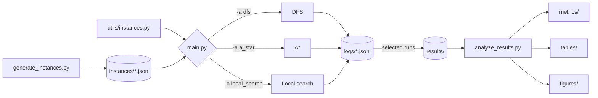

# Job Shop Scheduling Problem

> **Authors:** Eduardo Porto & Víctor Puga

**Report:** [JSP Project Report (PDF)](JSP_ProjectReport_EduardoPorto_VictorPuga.pdf)

Three approaches to the **Job Shop Scheduling Problem (JSSP)**: an exhaustive depth-first search, an informed A\* search and a local search metaheuristic. Every run is recorded as a structured JSON Lines log, so the methods can be compared on solution quality, search effort and running time.

## Table of Contents

- [Overview](#overview)
- [Project Structure](#project-structure)
- [Getting Started](#getting-started)
- [Usage](#usage)
- [Instances](#instances)
- [How It Works](#how-it-works)
- [Logging](#logging)
- [Benchmarks](#benchmarks)
- [Results](#results)
- [Testing](#testing)

## Overview

| Approach | Module | Type | Guarantees optimum | Variants |
|---|---|---|:---:|---|
| Depth-first search | `utils/dfs.py` | Exhaustive search | Yes | With pruning (default), `--no-prune` |
| A\* | `utils/a_star.py` | Informed search | Yes | Heuristics `lower_bound`, `machine_heads_tails` |
| Local search | `utils/local_search.py` | Metaheuristic | No | Neighborhoods `swap`, `insert`; random restarts |

The exact methods (DFS and A\*) show the cost of proving optimality, measured in visited states and time. Local search trades that guarantee for speed and is compared against the known optima.

## Project Structure

```text
.
├── main.py                        # CLI entry point
├── requirements.txt               # Python dependencies
│
├── utils/                         # Core library
│   ├── problem.py                 # JSSP model, search state and makespan computation
│   ├── instances.py               # Built-in instances, JSON loading and known optima
│   ├── generator.py               # Seeded random instance generator
│   ├── dfs.py                     # Depth-first search with optional pruning
│   ├── a_star.py                  # A* search with pluggable heuristics
│   ├── local_search.py            # Local search with swap/insert neighborhoods and restarts
│   ├── visualization.py           # Gantt chart of the best schedule
│   └── log.py                     # JSON Lines logging
│
├── scripts/
│   ├── generate_instances.py      # Writes the generated instances to instances/
│   ├── benchmark.sh               # Benchmark over the reference instances
│   ├── benchmark_instances.sh     # Benchmark over the generated instances
│   └── analyze_results.py         # Builds metrics, tables and figures from the logs
│
├── tests/                         # Unit tests (unittest)
│   ├── fixtures.py                # Small reusable instances
│   ├── oracle.py                  # Reference solutions used to validate the solvers
│   └── test_*.py                  # One test module per component
│
├── instances/                     # Generated problem instances (JSON)
├── logs/                          # One JSON Lines log per run
└── results/                       # Curated runs and derived analysis
```

### Data flow



1. Instances come from `utils/instances.py` (built-in) or from `instances/` (generated).
2. `main.py` solves an instance with the selected algorithm.
3. Each run writes its own log to `logs/`.
4. The runs used in the analysis are kept in `results/`, grouped by experiment.
5. `analyze_results.py` aggregates them into metrics, tables and figures.

## Getting Started

The project requires **Python 3.12**. Create and activate a virtual environment, then install the dependencies:

```bash
python3.12 -m venv .venv
source .venv/bin/activate
pip install -r requirements.txt
```

Generate the instance set and solve one instance:

```bash
python scripts/generate_instances.py
python main.py -a a_star -i ft06 --heuristic lower_bound
```

## Usage

```bash
python main.py [options]
```

`python main.py --help` lists every option. Unknown algorithms, instances or heuristics are rejected by the argument parser.

| Option | Applies to | Default | Description |
|---|---|---|---|
| `-a`, `--algorithm` | all | `dfs` | `dfs`, `a_star` or `local_search` |
| `-i`, `--instance` | all | `example` | Instance name (see [Instances](#instances)) |
| `--heuristic` | A\* | `machine_heads_tails` | `lower_bound` or `machine_heads_tails` |
| `--no-prune` | DFS | off | Disable pruning |
| `--seed` | local search | `42` | Random seed |
| `--neighborhood` | local search | `swap` | `swap` or `insert` |
| `--restarts` | local search | `10` | Number of random restarts |
| `--visualize` | all | off | Show a Gantt chart of the best schedule |
| `--log-nodes` | all | off | Log every node and neighbor (see [Logging](#logging)) |

### Examples

```bash
# DFS with and without pruning
python main.py -a dfs -i ft06_4x4
python main.py -a dfs -i ft06_4x4 --no-prune

# A* with each heuristic
python main.py -a a_star -i ft06 --heuristic lower_bound
python main.py -a a_star -i ft06 --heuristic machine_heads_tails

# Local search with the insert neighborhood
python main.py -a local_search -i la01 --neighborhood insert --seed 3 --restarts 20

# Show the resulting schedule
python main.py -a a_star -i ft06 --visualize
```

### Output

At the end of the search the program prints:

- the best makespan found
- the number of visited states
- the search time
- the dispatch sequence
- the order of operations on each machine
- the start time of each operation
- the path of the log file

For DFS, visited states count `search` calls. For A\*, they count expanded states; skipped duplicates are not included.

### Visualization

`--visualize` opens a Gantt chart of the best schedule once the search ends, with one row per machine and one color per job. It requires `matplotlib`, included in `requirements.txt`. The program exits when the window is closed.

## Instances

### Built-in instances

Defined as the keys of `INSTANCES` in `utils/instances.py`. Their known optima are stored in `OPTIMAL_MAKESPANS`.

| Name | Source | Size (jobs × machines) | Optimal makespan |
|---|---|:---:|:---:|
| `example` | Small example (default) | 4 × 3 | — |
| `ft06_4x4` | `ft06` restricted to its first 4 jobs and machines 0–3 | 4 × 4 | 33 \* |
| `ft06` | Fisher & Thompson | 6 × 6 | 55 |
| `la01` | Lawrence | 10 × 5 | 666 |
| `ft10` | Fisher & Thompson | 10 × 10 | 930 |
| `la36` | Lawrence | 15 × 15 | 1268 |

\* Computed with the DFS solver; not an official benchmark value.

### Generated instances

`scripts/generate_instances.py` creates 20 instances in `instances/`. Instance `i`, in `GENERATED_SPECS` order, uses seed `base_seed + i`, so the set is reproducible.

```bash
python scripts/generate_instances.py            # base seed 2026
python scripts/generate_instances.py --seed 7   # custom base seed
```

| Family | Count | Size (jobs × machines) | Durations |
|---|:---:|---|:---:|
| `gen_easy_01` – `gen_easy_10` | 10 | 3 × 3 or 4 × 4 | 1–10 |
| `gen_medium_01` – `gen_medium_08` | 8 | 5 × 5, 6 × 6 or 7 × 7 | 1–50 |
| `gen_hard_01` – `gen_hard_02` | 2 | 10 × 10, 15 × 10 | 1–99 |

Every `instances/<name>.json` file is available to `main.py` as an instance called `<name>`. Generated instances have no known optimal makespan.

> [!WARNING]
> The medium and hard instances are far too large for an exhaustive DFS and can run for a very long time.

### File format

An instance is a JSON object with two `n_jobs × n_machines` matrices:

```json
{
  "machines": [
    [2, 3, 1, 0],
    [0, 1, 2, 3],
    [2, 1, 3, 0],
    [3, 1, 0, 2]
  ],
  "durations": [
    [4, 10, 10, 9],
    [10, 8, 4, 1],
    [2, 8, 1, 8],
    [5, 6, 6, 7]
  ]
}
```

| Field | Meaning |
|---|---|
| `machines[j][k]` | Machine (0-based) that processes the k-th operation of job `j` |
| `durations[j][k]` | Processing time of that operation |

Each row is the fixed processing order of a job, and each job visits every machine exactly once. Job 0 in the example above reads as:

| Operation | 1st | 2nd | 3rd | 4th |
|---|:---:|:---:|:---:|:---:|
| Machine | M2 | M3 | M1 | M0 |
| Duration | 4 | 10 | 10 | 9 |

The objective is to minimize the **makespan**, the completion time of the last operation.

## How It Works

DFS and A\* search an operation-sequence (dispatching) state space, implemented in `utils/problem.py`, `utils/dfs.py` and `utils/a_star.py`.

| Element | Definition |
|---|---|
| **State** | A partial schedule (`State`): the next operation of each job (`next_operation`), when each job and machine becomes free (`job_free`, `machine_free`) and the jobs dispatched so far (`sequence`). Its makespan is the latest time any machine becomes free. |
| **Action** | Dispatch the next operation of one job. It starts as soon as both its job and its machine are free. |
| **Goal** | Every operation has been dispatched. The makespan of that state is the makespan of the schedule. |

Every state is feasible, so no cycle or precedence checks are needed. The reachable schedules are semi-active, and an optimal schedule is always among them. Each node has at most one child per job with operations left.

A schedule is represented by its `sequence`: a list in which each job appears once per operation, so the k-th occurrence of a job is its k-th operation. `Problem.start_times(sequence)` converts a sequence into the start time of every operation.

## Logging

Each run writes a JSON Lines log (one JSON object per line) to a new file and prints its path.

### File naming

```text
logs/<algorithm>_<instance>_<tag>_<YYYYMMDD>_<HHMMSS>_<mmm>.jsonl
```

| Algorithm | Tag | Example |
|---|---|---|
| DFS | `prune` or `noprune` | `dfs_ft06_noprune_20261028_171455_123.jsonl` |
| A\* | heuristic name | `a_star_ft06_lower_bound_20261029_151739_403.jsonl` |
| Local search | `<neighborhood>_seed<N>` | `local_search_la01_swap_seed3_…jsonl` |

The timestamp has millisecond precision and the file is created exclusively, so a run never appends to an existing log.

### Events

Every line contains `ts`, `level` and `event`, plus the fields of that event.

| Event | Algorithm | When |
|---|---|---|
| `start` | all | Once, at the beginning of the run |
| `new_best` | DFS, local search | Each time a better makespan is found |
| `progress` | DFS | Every 100,000 visits |
| `progress` | A\* | Every 10 expansions |
| `solution` | A\* | When the goal state is reached |
| `restart_done` | local search | At the end of each restart |
| `done` | all | Once, with the final result |

<details>
<summary><code>start</code>: run description</summary>

```json
{
  "ts": "2026-10-29T18:53:23.939",
  "level": "INFO",
  "event": "start",
  "instance": "example",
  "algorithm": "a_star",
  "n_jobs": 4,
  "n_machines": 3,
  "heuristic": "lower_bound",
  "log_nodes": false,
  "python": "3.12.11",
  "platform": "macOS-27.0.1-arm64-arm-64bit",
  "machine": "arm64",
  "git_commit": "7180ec1017fff01b6f47c6891e31420a062a15d1",
  "argv": ["main.py", "-a", "a_star", "-i", "example", "--heuristic", "lower_bound"]
}
```

| Field | Description |
|---|---|
| `algorithm`, `instance`, `n_jobs`, `n_machines` | What was solved |
| `prune` | DFS option |
| `heuristic` | A\* option |
| `seed`, `neighborhood`, `max_iterations`, `restarts` | Local search options |
| `log_nodes` | Whether node-level logging is enabled |
| `python`, `platform`, `machine` | Execution environment |
| `git_commit` | Code version (`null` outside a git checkout) |
| `argv` | Full command line |

</details>

<details>
<summary><code>progress</code>: A* search snapshot</summary>

```json
{"ts": "2026-10-29T18:53:23.941", "level": "INFO", "event": "progress",
 "visited": 130, "f": 26, "depth": 5, "frontier": 222, "pushed": 467}
```

| Field | Description |
|---|---|
| `visited` | States expanded so far |
| `f` | `f = g + h` of the state being expanded |
| `depth` | Number of operations dispatched in that state |
| `frontier` | Size of the open list |
| `pushed` | Total states added to the open list |

</details>

<details>
<summary><code>new_best</code>: improved solution</summary>

```json
{"ts": "...", "level": "INFO", "event": "new_best", "makespan": 59, "visited": 120, "sequence": [0, 1]}
```

In local search it also includes `restart` and `iteration`.

</details>

<details>
<summary><code>done</code>: final result</summary>

| Field | Description |
|---|---|
| `algorithm`, `instance` | What was solved |
| `prune` / `heuristic` / `seed`, `neighborhood` | Algorithm options |
| `best` | Best makespan found |
| `visited` | Total visited states |
| `elapsed` | Total search time in seconds |
| `time_to_best` | Seconds until the last `new_best` or `solution` (absent if none was found) |
| `max_frontier` | Largest frontier size reached (A\* only) |
| `optimal` | Known optimal makespan from `OPTIMAL_MAKESPANS` |
| `reached_optimal` | Whether `best` equals `optimal` |

</details>

## Benchmarks

Both benchmark scripts stop each run after `TIMEOUT` seconds (default `60`, the assignment budget). Set `TIMEOUT=0` to disable the limit.

```bash
bash scripts/benchmark.sh
TIMEOUT=0 bash scripts/benchmark.sh
```

The solvers have no internal time limit, so a DFS or A\* run stopped by the timeout leaves a log without a `done` event.

### Reference instances

`scripts/benchmark.sh` regenerates the benchmarks used in the report. The slowest cases (DFS on `ft06`; A\* on `la01`, `ft10` and `la36`) are commented out in the script's `CASES` list; uncomment them to include them.

### Generated instances

```bash
bash scripts/benchmark_instances.sh                         # every instances/*.json file
bash scripts/benchmark_instances.sh gen_easy_01 gen_hard_02 # selected instances
```

For each instance it runs DFS, A\* with both heuristics, and local search with both neighborhoods over seeds 1–10.

## Results

`results/` contains the runs used in the analysis, grouped by experiment, and the outputs derived from them.

| Path | Content |
|---|---|
| `*.jsonl` | Reference DFS and A\* runs on `example`, `ft06_4x4` and `ft06` |
| `final_benchmarks/` | Logs of the runs reported in the final report |
| `max_60_seconds/` | Runs under the 60-second budget |
| `local_search/` | Local search runs |
| `local_search_neighborhood_benchmarks/` | Comparison of the `swap` and `insert` neighborhoods |
| `metrics/` | Aggregated metrics per run and per instance |
| `tables/` | Summary tables used in the report |
| `figures/` | Plots and Gantt charts |
| `compressed/` | Compressed copies of large logs |

Regenerate the metrics, tables and figures with:

```bash
python scripts/analyze_results.py
```

## Testing

The tests use the standard library `unittest`, so no extra dependencies are required. Run them from the project root with the virtual environment active:

```bash
python -m unittest discover -s tests -t .
```

Run a single module with verbose output:

```bash
python -m unittest tests.test_a_star -v
```